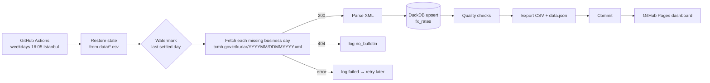

# TCMB FX Rates Pipeline

**An incremental, idempotent pipeline that loads the Central Bank of the Republic of Türkiye's daily exchange-rate bulletin into DuckDB every business day, checks the data, and publishes a live dashboard. It runs on GitHub Actions with no server.**

**[Open the live dashboard →](https://lidianarhoro88.github.io/tcmb-fx-rates-pipeline/)**

## Why this is more than a download script

Pulling one XML file is easy. Running it every day without supervision is the real work:

| Situation | How the pipeline handles it |
|---|---|
| Weekends | Not requested at all |
| Public holidays (29 Oct, Ramadan and Sacrifice feasts…) | The 404 is logged as `no_bulletin` and never fetched again |
| The job did not run for a week | `daily` starts from the **watermark** (last settled date) and fills every gap |
| Network error or timeout | Retried with backoff; the day is logged as `failed` and retried on the next runs |
| The same day loaded twice, or a corrected bulletin | Upsert on `(rate_date, currency)`: no duplicates, latest values win |
| Bulletin not out yet (before ~15:30) | "Today" is only attempted after 15:45 Istanbul time |
| JPY quoted per 100 units | `try_per_unit = forex_selling / unit` |
| Blank banknote rates (e.g. SDR) | Stored as NULL, not 0 |
| CI runners start empty | State lives in `data/fx_rates.csv` and `data/ingestion_log.csv`, restored at the start of every run |

## Flow



## Data model

`fx_rates`: one row per bulletin date and currency

| Column | Notes |
|---|---|
| `rate_date`, `currency` | primary key |
| `bulletin_no`, `unit`, `currency_name` | as published |
| `forex_buying`, `forex_selling`, `banknote_buying`, `banknote_selling` | TRY per `unit` |
| `try_per_unit` | forex selling per 1 unit, comparable across currencies |

`ingestion_log`: one row per attempted business day with status `loaded` / `no_bulletin` / `failed`.

The full history is in [`data/fx_rates.csv`](data/fx_rates.csv), ready for Power BI, Excel or pandas.

## Quality checks

Run after every load and shown on the dashboard: selling ≥ buying, all rates positive, USD/EUR/GBP present in every bulletin, and no currency moving more than 15 % between two bulletins (flagged for review, since that is more likely a data problem than a market move).

## Run it locally

```bash
pip install -e ".[dev]"
pytest -q                                     # uses XML fixtures, no network
fx-pipeline backfill --start 2026-01-01       # load history
fx-pipeline daily                             # incremental from the watermark
fx-pipeline export                            # data/fx_rates.csv, docs/data.json
fx-pipeline check                             # exit 1 if quality checks fail
python -m http.server -d docs                 # dashboard on http://localhost:8000
```

## Tests

`pytest` covers parsing (including the per-100 JPY unit and blank banknote rates), URL building, weekend skipping, the 15:45 publication cutoff, holiday handling, idempotency, retry of failed days, upsert of a corrected bulletin, every quality check, the export, and restoring state from CSV. Test fixtures follow the CBRT XML format with made-up values.

## Structure

```
src/fx_pipeline/
  source.py     URL building, HTTP with retries, XML parsing
  store.py      DuckDB schema, upsert, ingestion log, watermark, CSV restore
  quality.py    data quality checks
  pipeline.py   backfill / daily / export / check commands
docs/index.html dashboard (GitHub Pages)
.github/workflows/daily.yml  schedule, tests, load, commit
```

Rates are the CBRT's indicative rates for information only. This project is not affiliated with the CBRT and is not investment advice.
